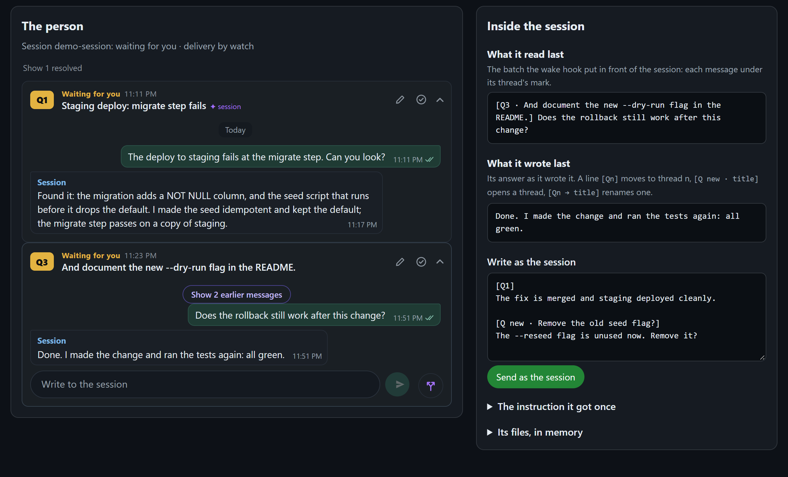

# ai-threads

Threads between a person and one AI coding session, and the delivery of their messages into it: you write to a Claude Code session from somewhere else (a web page, a phone, a bot) and the message reaches it whether it is idle, mid-turn or just starting, with nobody pressing Enter. You keep several subjects open with the same session, each its own thread, and the session's replies come back split by thread. Plain files, a documented protocol, zero dependencies.

[](https://github.com/rbritta/ai-threads/actions/workflows/ci.yml) [](https://github.com/rbritta/ai-threads/releases) [](LICENSE) [](https://rbritta.github.io/ai-threads/demo/)



**[Live demo](https://rbritta.github.io/ai-threads/demo/)** · [Install](#install) · [Quick start](#quick-start) · [How it works](#how-it-works) · [The Q markup](#the-q-markup) · [With chat-thread](#with-chat-thread) · [API](#api) · [Configuration](#configuration) · [Protocol](docs/PROTOCOL.md) · [For AI agents](AGENTS.md) · [Roadmap](TODO.md)

## What it does

- **Delivery in any state.** A message reaches the session whether it is idle, mid-turn or just starting, with nobody pressing Enter: Claude Code hooks watch a signal file, a Stop hook stands guard while the session is idle, and anything still waiting rides along with the next prompt.
- **Numbered threads.** Several subjects with the same session, each its own thread (Q1, Q2...). The session learns a plain-text markup from one short instruction, and its replies come back split by thread; it can open a thread of its own or retitle one.
- **Exactly once.** Each message is claimed by one atomic rename, so the watch, the Stop hook and the prompt hook never deliver the same one twice. `events.jsonl` says what was queued and delivered, and how.
- **Ready for a chat screen.** `view()` returns the threads in the shape [chat-thread](https://github.com/rbritta/chat-thread)'s `createThreads` takes: titles, states, what the session is doing, queued, delivered and read messages.
- **A documented file protocol.** Plain files under one folder, so a program in any language sends and reads the same way ([docs/PROTOCOL.md](docs/PROTOCOL.md), with an example in Python; the tests run a second implementation in Python against the library).
- **Small and offline.** Zero runtime dependencies, CommonJS, Node 22+, with a CLI. Nothing calls a model, reads your code or sends anything over the network.

The [live demo](https://rbritta.github.io/ai-threads/demo/) runs the library itself in the browser, on a file system in memory, with a pretend session that answers in the markup.

## Install

Node 22 or later, and Claude Code for the delivery. No runtime dependencies; pin a commit (`github:rbritta/ai-threads#<commit>`) or a release tag for repeatable installs.

```sh
npm install github:rbritta/ai-threads
npx ai-threads install          # adds the hooks to ~/.claude/settings.json (backed up once)
```

`install --settings <file>` targets a project's `.claude/settings.local.json` instead. The hooks run from
a copy at `<home>/runtime`, so they keep working if the package moves; `ai-threads remove` takes them out.
`--rewake-message <text>` and `--rewake-summary <text>` set the line the session reads above a batch that
woke it and the short label Claude Code shows; installing again without them keeps what is installed.

## Quick start

From your app:

```js
const threads = require('ai-threads');
const at = threads.open(); // home: AI_THREADS_HOME or ~/.ai-threads

const q = at.deliverSync(sessionId, 'Is the deploy fixed?');         // opens Q1
at.deliverSync(sessionId, 'And on staging?', { thread: q.n });       // more in Q1
at.notice(sessionId, 'CI is slow today.');                           // no thread, no reply expected

at.listening(sessionId);   // { listening: true, why: 'watch', alive: true, busy: false, ... }
at.view(sessionId);        // { session, threads } for chat-thread
```

Or from a shell, from any language:

```sh
ai-threads send <session> "Is the deploy fixed?"
ai-threads send <session> --file reply.txt --thread 1
ai-threads list --json
ai-threads status
```

Programs that would rather not run Node read and write the same files: [docs/PROTOCOL.md](docs/PROTOCOL.md)
has the layout, the steps and an example in Python.

## How it works

Claude Code has no API to push a message into a running session, but its hooks can wake one: a hook
marked `asyncRewake` that exits with code 2 puts its stderr in front of the session as the next thing to
act on, idle or busy. ai-threads builds the delivery on that:

1. **An inbox per session.** `deliver()` writes the message to `<home>/sessions/<session>/inbox/` and
   touches the session's `signal` file.
2. **The watch.** At start, the session is told to watch its `signal` (SessionStart `watchPaths`). A touch
   fires the FileChanged hook, which claims every waiting message and wakes the session with them.
3. **Fallbacks.** A session that starts with messages already waiting is re-touched a few times, since
   its watcher comes up only after the start hooks return. While it sits idle, a Stop hook (the vigia)
   looks every 2 seconds, in case the watcher went down; it runs only in sessions ai-threads is used in
   (registered, or sent a message once). Anything still waiting rides along with the next prompt the
   person types.
4. **Claimed once.** Each message is claimed by one atomic rename into `delivered/`, so the watch, the
   vigia and the prompt hook never deliver the same one twice. `events.jsonl` says what was queued and
   delivered, and how.

What the session reads:

```
[Q3 · Deploy fails] Is it fixed now?

[Q5 · Docs] Update the README too.
```

Two rules keep it working next to other tools in the same session: the signal file is only ever
overwritten, never removed or renamed (Claude Code keeps one file watcher per session, shared by every
tool, and a removed watched file can take it down for all of them), and no hook but SessionStart returns
`watchPaths`.

## The Q markup

The session learns it from one short instruction, sent once with the first message that has a thread
(the built-in one, or your own text, in any language, with `instructions`):

| The session writes, alone on a line | Meaning |
|---|---|
| `[Q3]` | what follows goes to thread 3, until the next mark |
| `[Q new · Should we cache?]` | opens a thread (derived from the one it was in), the text below is its first message |
| `[Q3 → Login timeout on mobile]` | gives thread 3 a better title |

A reply with no mark goes to the thread of the last message delivered. An instruction of your own in
another language can teach its own word for `new`: list it in `newWords`. Text the person types straight into the session becomes the "typed in the IDE" thread.
After a resume, a `/clear` or a compaction, the session is reminded of the markup.

## With chat-thread

`view()` returns the session's threads in the shape `createThreads` takes, so the page only wires the
callbacks to your server:

```js
// server
app.get('/api/session/:id', (req, res) => res.json(at.view(req.params.id, { persist: true })));
app.post('/api/session/:id/send', (req, res) => {
  const { text, thread, parent } = req.body;
  const r = at.deliverSync(req.params.id, text, { thread, parent });
  res.json(at.view(req.params.id).threads.find((t) => t.id === r.thread));
});
app.post('/api/session/:id/resolve', (req, res) => res.json(at.resolve(req.params.id, req.body.thread)));

// browser
const box = createThreads(el, {
  mode: 'questions',
  threads: (await (await fetch(`/api/session/${id}`)).json()).threads,
  onSend: (threadId, text) => post('send', { thread: threadId, text }),
  onNewThread: (text, parentId) => post('send', { text, parent: parentId }), // resolves to the new thread
  onResolve: (threadId) => post('resolve', { thread: threadId }),
});
// then, every few seconds: box.upsert(thread) for each thread of a fresh GET
```

Each thread has `id` (`q3`), `n`, `title`, `titleByAI`, `status`, `tone`, `label`, `activity` (what the
session is doing while it works on that thread), `origin`, `parent` and `messages`; each message has
`id`, `from` (`me` or `other`), `text`, `at` and `state` (`queued`, `delivered`, `read`). A queued
message can be taken back with `retract()` (chat-thread's × on a queued bubble).

## API

`threads.open({ home, claudeDir, config, liveness, transform, onEvent })` returns:

| Sending | |
|---|---|
| `deliverSync(session, text, opts)` | Queue a message and touch the signal. `opts.thread` (3 or `'q3'`; omitted opens a new thread; `false` for none), `ref` (your own id for the thread, below), `title`, `parent`, `type`, `alert`, `release` (a key or a list), `from`, `footer`, `meta`, `kind: 'notice'`, `retouch` (for a session that is just starting). Returns `{ id, thread, n }`. |
| `deliver(session, text, opts)` | The same after the transform (below), as a promise. |
| `notice(session, text)` | A message with no thread and no reply expected. |
| `retract(session, id, { reason })`, `retracted(session)` | Take back a message still waiting; what was taken back. |
| `handBack(session, { to })` | Move what the session never read to another session, or out to `returned/`. |

| Threads | |
|---|---|
| `threads(session)`, `thread(session, n)`, `thread(session, { ref })` | The registry; one thread by number or by your own id. |
| `openThread(session, { title, text, by, type, alert, release, parent, ref })` | Open a thread from either side. Opened by the session, `text` is its ask. |
| `rename`, `resolve`, `reopen`, `setThread` | Change one. Writing in a resolved thread reopens it. |
| `answers(session, { release })`, `latestAnswer(session, release)` | The person's answers to threads with a release key, for a policy hook. |
| `view(session, { persist, labels })` | Everything above plus the transcript, for chat-thread. |
| `replies(session, n or { ref }, { since })` | What the session answered in one thread, from its transcript: `[{ id, text, at }]`. |

| The session | |
|---|---|
| `listening(session)` | Whether it gets a message by itself now, and why. |
| `pending`, `delivered`, `events`, `followEvents(cb)` | What waits, what was delivered, and the event log. |
| `register(session, { title, app, instruction, instructed })` | What the instruction says, and whether the session was already told. |
| `claim`, `formatDelivery`, `arm`, `disarm`, `tick` | What the hooks use, for a host other than Claude Code. |

**Your own thread ids.** An app that keeps conversations of its own sends with `ref: '<its id>'` and no
`thread`: the message goes to the thread that has that ref, or opens one that keeps it. `thread(session,
{ ref })` and `replies(session, { ref })` find it again, and `view` returns `ref` on each thread.

**Footers.** A message may carry a `footer`, a closing paragraph such as how to answer. A batch prints each
distinct footer once, after its messages, so three messages with the same footer read it once.

`require('ai-threads/markup')` has the parser and formatter alone; `require('ai-threads/claude-code')` has
the hooks, the transcript reader and the installer.

## Configuration

`<home>/config.json`, every key optional:

| Key | Default | |
|---|---|---|
| `app` | `"an app"` | Who follows the session, in the instruction. |
| `instructions` | `true` | `false` never sends it; a string replaces it (`{app}` is filled in), in any language. |
| `newWords` | `[]` | Words besides `new` that open a thread (`[Q <word> · title]`), for an instruction of your own in another language. |
| `entrypoints` | all | Deliver only in sessions from these `CLAUDE_CODE_ENTRYPOINT`s, e.g. `["claude-vscode"]`. |
| `touches` | `[4, 12, 30]` | Seconds between re-touches after a session starts with messages waiting. |
| `vigia` | `{ "stepMs": 2000, "maxMs": 84600000, "aliveCheckMs": 60000 }` | The Stop fallback. |
| `maxText` | `20000` | Longest message, in characters. |
| `transform` | none | A module (path from the home) exporting `async (text, { session_id, thread, from }) => text`, run before a message is queued: translation, say. The original is kept in `original`. Never runs inside a hook. |
| `onEnd` | `"keep"` | When a session ends, `keep` its undelivered messages for when it comes back, or `return` them. |
| `piggybackHeader` | `"Messages for this session that were waiting (ai-threads):"` | The line above messages that ride along with a typed prompt; `""` for none. |
| `onDelivered` | none | `{ "command": [...] }`: run after every claimed batch, by whichever hook claimed it, with `{ event: "delivered", session_id, via, messages }` on stdin. An app's delivered tick without following `events.jsonl`. |
| `tick` | none | `{ "command": [...], "everyMs": 60000 }`: run while a session sits idle (by its vigia, at most once per `everyMs`) and on every touch of its signal (by the wake), with `{ event: "tick", session_id, via }` on stdin. A co-installed tool's periodic check, with no idle process or watch of its own. |

A `command` is an argv list (no shell) or one string (run through the shell). It runs detached with
`AI_THREADS_HOME` set; its output is ignored and nothing waits for it.

## Limits

- Claude Code only, for now; the core (inbox, threads, markup) has no Claude Code in it, and the hooks
  are a thin adapter.
- Delivery needs the hooks installed in the session's settings, and Claude Code's `asyncRewake` and
  `FileChanged` hooks.
- One machine: the files are local. A remote app reaches them through its own server.
- Nothing here calls a model, reads your code or sends anything over the network.

## Part of a small family

Each works alone; together they need no glue code.

| Project | What it does |
| --- | --- |
| [ai-signalbox](https://github.com/rbritta/ai-signalbox) | A coordination layer for several AI coding sessions on one machine: who is doing what, shared resources, asks and threads with the person. |
| **ai-threads** | Numbered threads between a person and one AI coding session, and the delivery of each message into it. |
| [chat-thread](https://github.com/rbritta/chat-thread) | The conversation on screen: bubbles, ticks, threads and the message box. ai-threads' `view()` returns threads in the shape its `createThreads` takes. |
| [postit-board](https://github.com/rbritta/postit-board) | A glass board of sticky notes for an app's home screen, with notes the app pins and takes down by itself. |
| [claude-session-relay](https://github.com/rbritta/claude-session-relay) | Drive the Claude Code tabs of any VS Code window from a script, a bot or a web panel, through a plain file inbox. |

## Develop

```sh
git clone https://github.com/rbritta/ai-threads.git && cd ai-threads
npm ci                 # only playwright-core, for the demo's browser test and its screenshot
npm test               # everything, offline: core, hooks, CLI, installer, protocol, the demo
npm run test:coverage  # the same, with a coverage summary of src/
npm run demo           # http://localhost:5177/demo/
npm run build:demo     # demo/ai-threads.js, the browser build pages.yml publishes
npm run screenshots    # docs/demo.png
```

99 tests, in about eight seconds: 94 in Node (among them the demo's browser build, run in a bare `vm` context) and 5 in a real browser on the demo page. Tests run in temp folders with a fake Claude Code registry: they never touch `~/.claude` and never call a model. The protocol tests also run a Python implementation when Python 3.8+ is on the PATH, and say so when they skip. The browser test pins the language, the time zone and the clock, and skips with the reason when no browser is installed (CI makes that an error).

The demo is `demo/`: `demo.js` plays Claude Code and the AI around the real library, `vendor/` is chat-thread's `dist/` copied as it is, and `ai-threads.js` is built from `src/` by `scripts/build-demo.mjs` (served fresh by `npm run demo`, never committed).

## Contributing

Issues and pull requests are welcome; keep it dependency-free. [CONTRIBUTING.md](CONTRIBUTING.md) has the setup, what a pull request needs and how releases are made, and [SECURITY.md](SECURITY.md) how to report a vulnerability privately. Everyone taking part follows the [Code of Conduct](CODE_OF_CONDUCT.md).

## License

[MIT](LICENSE)
